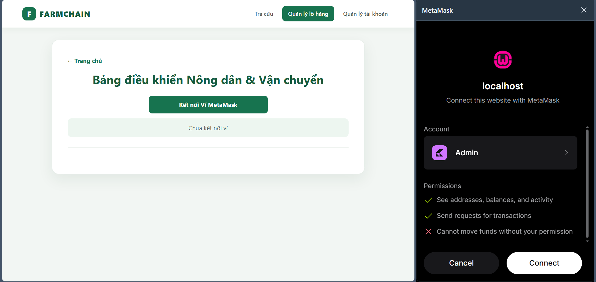
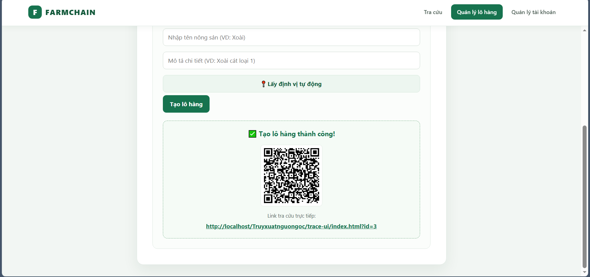
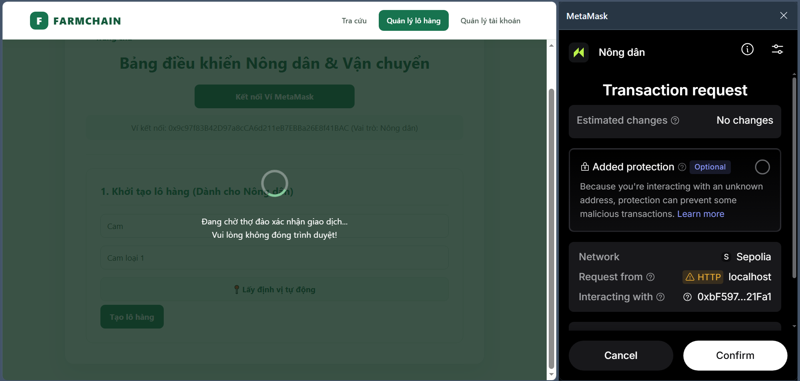
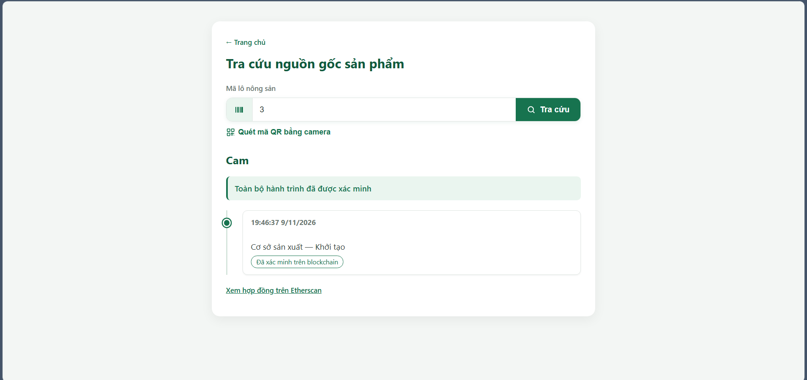
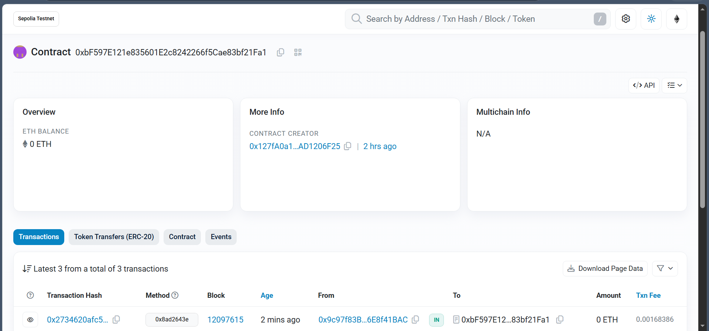
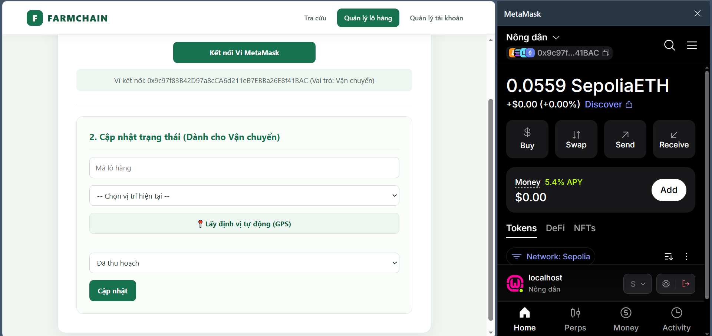
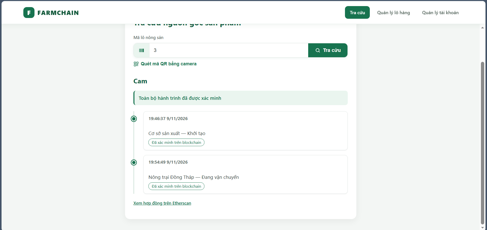

Hướng dẫn sử dụng:

1. Lên phpmyadmin chạy sql nếu đang dùng csdl cũ (nếu có đổi tên csdl nhớ sửa lại trong db.php và .env)
2. Mở remix vào thư mục smart-contract có file SupplyChainABI.sol deploy file đó
3. Thanh bên trái chọn Compile (dưới search) kéo xuống bấm Copy ABI rồi dán vào SupplyChainABI.json ở thư mục gốc
4. Thanh bên trái vào deploy chọn đúng enviroment (mạng sepolia) rồi bấm deploy, qua tab deployed contract copy địa chỉ mới deploy rồi dán vào .env
5. Truy cập trang web ở trang chủ bấm kết nối ví lần đầu kết nối sẽ như hình (quan trọng bấm vào account chon 2 tài khoản 1 để làm admin 1 để làm nông dân chọn 2 tài khoản thi nó sẽ ghi là 2 account) rồi connect
6. Sau đó nó hỏi thì kí chữ kí (do tài khoản chưa có trên csdl thì nó sẽ chờ admin duyệt nếu chưa có có admin thì chạy cái này trên csdl)
   ```SQL
   UPDATE users
   SET role = 'admin'
   WHERE wallet_address = 'ĐỊA_CHỈ_VÍ_META_MASK_BẠN_MUỐN_LÀM_ADMIN';
   ```
7. Xong thì vào trang quản lí tài khoản chọn địa chỉ ví thứ 2 (nông dân) bấm kết nối ví nó sẽ ghi chờ duyệt đổi lại tài khoản admin duyệt là Nông dân
8. Ở tài khoản role nông dân hãy tạo lô hàng bấm tạo lô hàng thì bấm confirm chờ giao dịch thành công có thể quét qr hoặc bấm vào link để tra cứu
9. Trang tra cứu có thể xem được timeline của sản phẩm bấm vào xem hợp đồng trên Etherscan để xác nhận
10. Để cập nhật timeline tiếp theo chọn lại tài khoản admin sửa quyền tài khoản nông dân thành vận chuyển sau đó vào lại tài khoản nông dân đã sửa thành vận chuyển đó để cập nhật ghi mã lô hàng muốn cập nhật chọn vị trí trạng thái bấm cập nhật rồi kí chữ kí
11. Quay lại trang tra cứu để kiểm tra 
